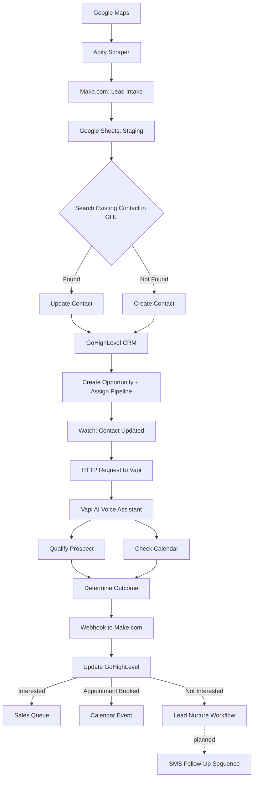

# AI SDR Automation System — Workflow Mapping

Technical reference for how a lead moves through the system, platform by platform. Companion doc to `AI_SDR_SOP.md`.

---

## 1. High-Level Flow

**Status legend:** solid path = live in production. The SMS Follow-Up branch (Phase 6) is planned but not yet built — see Section 6.

---

## 2. Phase-by-Phase Mapping

### Phase 1 — Lead Acquisition
| | |
|---|---|
| **Trigger** | Manual or scheduled Apify run |
| **Input** | Search parameters: business category, location |
| **Platform(s)** | Apify → Make.com → Google Sheets |
| **Data extracted** | Business Name, Phone Number, Website, City |
| **Output** | Row(s) in Google Sheets staging tab |
| **Next trigger** | New-row watch on Google Sheets (Make.com) |

### Phase 2 — CRM Intake & Deduplication
| | |
|---|---|
| **Trigger** | New row in Google Sheets |
| **Platform(s)** | Make.com → GoHighLevel |
| **Logic** | Search Existing Contact (match field: **phone number** — confirm this is the actual match key configured in Make.com, since matching on name instead is the most common source of duplicate contacts) |
| **Branch: Found** | Update Contact |
| **Branch: Not Found** | Create Contact |
| **Output** | Single, deduplicated contact record in GHL |
| **Next trigger** | Contact created/updated in GHL |

### Phase 3 — Opportunity & Pipeline Setup
| | |
|---|---|
| **Trigger** | Contact created/updated (Phase 2 output) |
| **Platform** | GoHighLevel |
| **Actions** | Create Opportunity → Assign Sales Pipeline → Set Initial Lead Status |
| **Output** | Opportunity attached to contact, sitting at pipeline entry stage |
| **Next trigger** | "Watch Contact Updated" (Make.com) fires |

### Phase 4 — AI Voice Qualification
| | |
|---|---|
| **Trigger** | Watch Contact Updated → HTTP Request from Make.com to Vapi |
| **Platform(s)** | Make.com → Vapi AI → Twilio (call delivery) → OpenAI (conversation logic) |
| **Vapi responsibilities** | Introduce business, ask qualification questions, understand needs, handle basic objections, determine interest level, offer appointment times |
| **Data needed inbound** | Contact name, phone, business context/vertical (for the prompt) |
| **Output** | Call outcome + qualification data, held by Vapi until call ends |
| **Next trigger** | Call ends → Vapi sends outcome webhook |

### Phase 5 — Appointment Booking (sub-flow of Phase 4)
| | |
|---|---|
| **Trigger** | Prospect agrees to a time during the live call |
| **Platform** | Vapi AI ↔ GoHighLevel (via tool calls) |
| **Actions** | Check calendar availability → offer slots → confirm preferred time → create calendar event |
| **Output** | Calendar event created directly in GHL, no manual scheduling |
| **Failure mode to watch** | Booking tool-call can fail silently even when the overall call is marked successful — check tool-call logs specifically, not just call status (see SOP Section 5) |

### Phase 6 — Call Outcome Processing
| | |
|---|---|
| **Trigger** | Vapi webhook to Make.com at call end |
| **Platform(s)** | Vapi → Make.com → GoHighLevel |
| **Branch: Interested** | Update lead status, move opportunity to next pipeline stage, optional sales team notification |
| **Branch: Appointment Booked** | Confirm calendar event, update opportunity stage, trigger confirmation/reminder workflow |
| **Branch: Not Interested** | Update lead status, enroll contact in long-term lead nurture workflow |
| **Critical dependency** | This entire phase depends on the Vapi webhook payload shape staying consistent — any prompt change that adds/renames/removes an extracted field must be checked against this Make.com module (see SOP Section 4.3) |

### Phase 7 — SMS Follow-Up *(Planned Enhancement — not yet live)*
| | |
|---|---|
| **Trigger** | No-answer outcome on the AI call |
| **Planned platform(s)** | Make.com → Twilio |
| **Planned sequence** | SMS 1 immediately after no-answer → SMS 2 reminder at 24/48/72h → SMS 3 final follow-up |
| **Status** | Documented as a design intent in the original project spec; not implemented. Do not report this as active in any client-facing status update until built and tested. |

---

## 3. Data Field Reference

| Field | Originates in | Consumed by |
|---|---|---|
| Business Name | Apify scrape | GHL contact record, Vapi prompt (business context) |
| Phone Number | Apify scrape | GHL contact match key, Twilio/Vapi call target |
| Website | Apify scrape | GHL contact record (context only) |
| City | Apify scrape | GHL contact record, Vapi prompt (localization) |
| Qualification outcome | Vapi (from live call) | Make.com routing logic → GHL pipeline stage |
| Appointment time | Vapi ↔ GHL calendar tool call | GHL calendar event |

---

## 4. Ownership Handoff Points

These are the three places where a break in one platform silently breaks everything downstream — worth knowing by heart for troubleshooting:

1. **Google Sheets → GHL (Phase 2):** if the dedupe match field is wrong, every subsequent phase runs against duplicate/fragmented contact records.
2. **GHL → Vapi (Phase 4 trigger):** if "Watch Contact Updated" doesn't fire, leads sit in the CRM and are never called — this fails silently with no error, just no calls happening.
3. **Vapi → Make.com (Phase 6 trigger):** if the webhook payload shape changes, calls still happen but outcomes stop updating GHL correctly — the most dangerous failure mode because the system *looks* like it's working (calls are being made) while the CRM data quietly goes stale.
