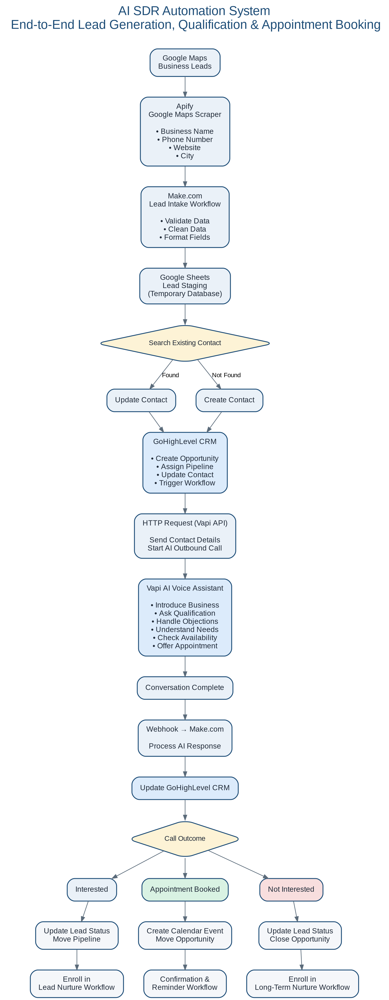

# AI SDR Automation System

> End-to-end AI Sales Development Representative (SDR) automation built with Apify, Make.com, GoHighLevel, Vapi AI, Twilio, APIs, and webhooks.
>
> **Client project.** Designed, built, and documented by Maria Fe Blanca. Client names, contact data, and credentials have been removed.

---

## Overview

The **AI SDR Automation System** is an end-to-end sales automation platform designed to eliminate repetitive outbound sales tasks by automating lead generation, qualification, appointment booking, and CRM updates.

Instead of relying on sales representatives to manually search for prospects, make qualification calls, and schedule meetings, this solution leverages AI and low-code automation to create a scalable outbound sales workflow.

This project demonstrates how modern AI tools and workflow orchestration can be combined to build a complete sales system without requiring a custom backend.

---

## Business Problem

Many small businesses struggle to scale outbound sales because their processes are heavily manual.

Common challenges include:

* Manual lead research
* Manual CRM data entry
* Time-consuming qualification calls
* Manual appointment scheduling
* Missed follow-ups
* Inconsistent sales tracking

These inefficiencies increase operational costs while reducing conversion rates.

---

## Solution

This project automates the complete outbound sales workflow:

* Scrapes business leads automatically
* Stores leads inside GoHighLevel
* Qualifies prospects using an AI voice assistant
* Books appointments automatically
* Updates CRM records in real time
* Runs SMS follow-up sequences through GoHighLevel until the lead books, replies, or changes status

---

# Technology Stack

| Technology    | Purpose                                 |
| ------------- | --------------------------------------- |
| Apify         | Google Maps lead collection             |
| Make.com      | Workflow Orchestration                  |
| Google Sheets | Lead Staging                            |
| GoHighLevel   | CRM & Pipeline                          |
| Vapi AI       | AI voice agent (system instructions and knowledge base engineered for this client) |
| OpenAI        | Language model behind the Vapi assistant |
| Twilio        | Phone number connected to GoHighLevel and Vapi for AI calls and SMS |
| HTTP APIs     | Platform Integrations                   |
| Webhooks      | Event Processing                        |

---

# System Architecture

---

# Workflow

## Phase 1 — Lead Generation

Business leads are collected from Google Maps using an Apify actor, started from Make.com ("Run an Actor").

Extracted data includes:

* Business Name
* Phone Number
* Website
* City

Make.com iterates over the results, checks Google Sheets for rows that already exist, adds new rows, then searches GoHighLevel and routes each lead to **Create Contact** or **Update Contact**.

---

## Phase 2 — CRM Processing

The automation:

* Searches for existing contacts
* Prevents duplicate records
* Creates new contacts
* Updates existing contacts
* Creates sales opportunities
* Assigns pipeline stages

---

## Phase 3 — AI Qualification

Once a lead is created and enters the Sales Prospect pipeline, a GoHighLevel workflow sends the contact data to Make.com, which calls the Vapi API (`POST /call`) to place an outbound AI call from the client's Twilio number.

I wrote the Vapi assistant's **system instructions and knowledge base**: the business context, qualification questions, objection handling, and the structured outcome the assistant returns at the end of each call.

The AI agent:

* Introduces the business
* Asks qualification questions
* Handles common objections
* Determines buying intent
* Offers available appointment slots

---

## Phase 4 — Appointment Booking

If qualified, the AI:

* Checks GoHighLevel calendar availability
* Books appointments automatically
* Updates CRM opportunities
* Sends booking confirmation

---

## Phase 5 — Outcome Processing

After every conversation, Vapi sends webhook data back into Make.com.

Possible outcomes include:

* Interested
* Appointment Booked
* Not Interested

Each outcome automatically updates the CRM and triggers the appropriate workflow.

---

## Phase 6 — SMS Follow-Up (GoHighLevel + Twilio)

The **Lead Scheduling Nurture** workflow in GoHighLevel sends SMS through the Twilio number to interested leads who have not booked yet.

**Triggers:** lead status changed to qualified, AI call outcome set to "Interested", or a positive customer reply.

**Sequence:** SMS #1 → wait 1 day → SMS #2 → wait 2 days → SMS #3 → wait 4 days → final nurture SMS → wait 3 days → lead status set to Nurture and tagged `Interested - Long Term Nurture`.

---

## How Follow-Up Stops

* **Booked appointment:** the nurture workflow checks for an appointment before every SMS and ends as soon as one exists.
* **Workflow goal:** the AI Lead Qualification workflow exits when an appointment is scheduled, the lead status changes, or the contact replies.
* **Replies and status changes:** a positive reply or a lead-status change ends the nurture sequence and notifies the sales team.
* **Duplicates:** Make.com checks Google Sheets and searches GoHighLevel before creating a contact, so a lead already in the system is updated instead of duplicated.

---

## Planned Enhancements

Future improvements include:

* Email nurturing campaigns
* Lead scoring
* Multi-language AI voice support
* Reporting dashboard
* Analytics
* Conversation summarisation

---

# Screenshots

| Screenshot | What it shows |
| --- | --- |
| [Apify lead intake (GHL)](Apify_Lead_Intake_Automation.png) | New-lead workflow: opportunity, owner, tags, phone check |
| [Leads scraped (Make.com)](Make_Automation_Scenario_2.png) | Apify → Sheets → iterator → GHL search → create or update |
| [AI call trigger (Make.com)](Make_Automation_Scenario_1.png) | GHL contact update → HTTP `POST /call` → Vapi |
| [Post-qualification (Make.com)](Make_Automation_Scenario_3.png) | Vapi webhook → GHL contact update |
| [AI lead qualification flow (GHL)](AI_Lead_Qualification_Flow.png) | Send to Make, call status, workflow goal exits |
| [SMS nurture workflow (GHL)](GHL_Workflow_Overview_1.png) | SMS sequence with appointment checks ([part 2](GHL_Workflow_Overview_2.png)) |

---

# Skills Demonstrated

* AI Workflow Automation
* Business Process Analysis
* Make.com Scenario Design
* API Integration
* Webhooks
* GoHighLevel CRM Architecture
* AI Voice Agents (Vapi)
* Prompt Engineering (system instructions and knowledge base)
* Twilio Integration (calls and SMS)
* SMS Follow-Up Sequences
* Calendar Automation
* Lead Qualification
* Sales Automation
* Data Synchronisation

---

# Key Outcomes

* Automated lead generation
* AI-powered qualification
* Automated appointment scheduling
* CRM synchronisation
* Reduced manual administrative work
* Scalable outbound sales process

---

# Author

**Maria Fe Blanca**

AI Automation & Systems Architect

Specialising in AI-powered workflow automation, CRM architecture, API integrations, and business process optimisation.
